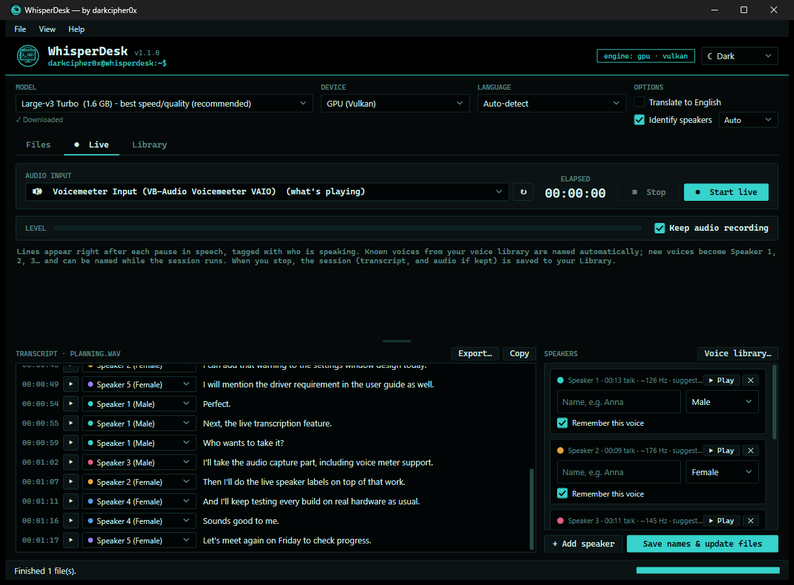
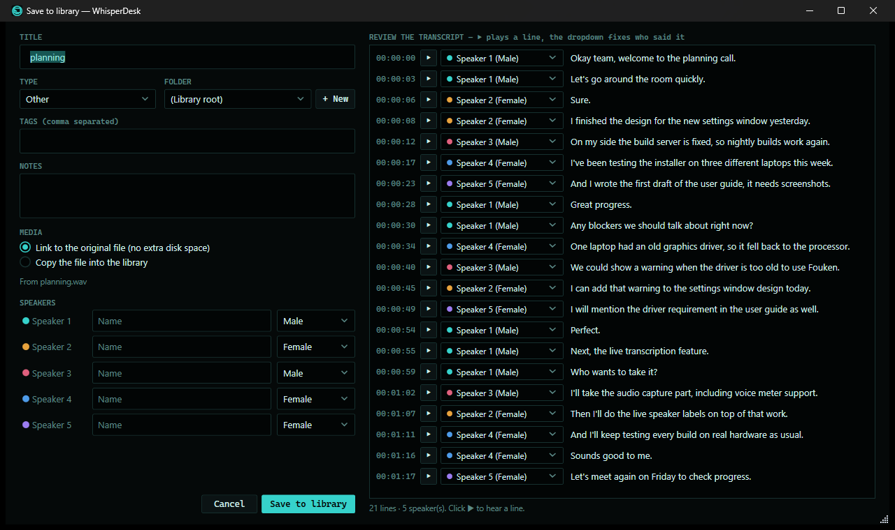

<p align="center">
  
</p>

<h1 align="center">WhisperDesk</h1>

<p align="center">
  <b>Private, on-device transcription for Windows.</b><br>
  Turn recordings and live audio into accurate, timestamped, speaker-labelled transcripts. Nothing is sent to the cloud.
</p>

<p align="center">
  
  
  
  
  
  
</p>

---

WhisperDesk is a desktop transcription app by **DarkCipher Systems**. It runs the open-source Whisper speech model on
your own PC: on the graphics card (Vulkan: AMD, NVIDIA or Intel), on an Intel NPU when the PC has one, or on the
processor. There is no account, no subscription, no telemetry and no cloud service.

<p align="center">
  
</p>

## Highlights

- **Files or live audio.** Drag in audio and video files or whole folders and transcribe them in a queue, or transcribe a
  microphone, Voicemeeter or what's playing on the PC line by line as people speak. Whisper models from Tiny to
  Large-v3 Turbo, 99 languages, optional translation to English.
- **Who said what.** Speaker identification labels every line (`[00:01:07] Speaker 2: …`). A voice library remembers
  named voices and recognises them in later recordings. Play any line to check it, rename speakers, fix mistakes.
- **An auditable record.** Every correction is logged with who, when, why and the original wording, and the log is part
  of every export. Reports carry SHA-256 fingerprints of the audio and the transcript.
- **Organise and export.** A searchable library with folders, types, tags and notes. TXT, SRT, VTT, JSON, Word and PDF,
  subtitles burned into video, or a self-contained player to share.
- **Optional offline summaries** (key points, actions, decisions) through a local AI server (Ollama) that you run.
- **Add-ons**, including an OBS caption overlay, a live text file and a webhook, plus an SDK for your own.

<p align="center">
  
</p>

## Security and privacy

- **Nothing connects at start-up.** Model downloads ask first (pinned revisions, SHA-256 verified), and every
  connection goes through one gate that logs it with the feature that made it (Settings → Security & privacy).
- **Optional encryption** of the whole library with AES-256-GCM: passphrase (PBKDF2-SHA256, 600,000 rounds) and a
  one-time recovery key, a lock screen with auto-lock, TOTP two-factor sign-in and Windows Hello.
- **Sandboxed add-ons.** Third-party add-ons run in a Windows AppContainer with only the permissions you approve.
- **Supply chain.** Locked package restore, NuGet audit, and a security test suite that must pass before anything is
  packaged.
- Design, threat model and limits: [docs/SECURITY-ARCHITECTURE.md](WhisperDesk/docs/SECURITY-ARCHITECTURE.md).
  Reporting a vulnerability: [SECURITY.md](.github/SECURITY.md).

## Download

Get the latest version from [**Releases**](../../releases/latest):

| File | What it is |
|---|---|
| `WhisperDesk-<ver>-x64.msi` | Installer: Start menu shortcut, upgrades older versions in place |
| `WhisperDesk-<ver>-x64-portable.zip` | Unzip and run, no install needed |
| `WhisperDesk-<ver>-User-Admin-Guide.pdf` | The full user and administrator guide (also in the app: Help → User & admin guide) |
| `WhisperDesk-Addon-SDK-<ver>.zip` | The add-on SDK: contract DLL, XML docs and a sample |
| `WhisperDesk-Addon-WordExport.zip` | The sample Word export add-on, ready to install |
| `SHA256SUMS.txt` | Checksums of every file above |

Requirements: Windows 10 or 11, x64; a CPU with AVX2; 8 GB RAM (16 GB recommended). A Vulkan GPU or an
Intel NPU is recommended but not needed. Reading most audio and video formats needs [FFmpeg](https://ffmpeg.org), a free
separate program (`winget install Gyan.FFmpeg`); WhisperDesk tells you if it's missing.

The MSI and zip are not code-signed yet, so Windows SmartScreen may show "unknown publisher". Check the download
against `SHA256SUMS.txt` (`Get-FileHash .\WhisperDesk-1.8.0-x64.msi`).

## Build from source

Requirements: Windows 10/11 x64 and the [.NET 8 SDK](https://dotnet.microsoft.com/download/dotnet/8.0). Everything else
(WiX, the MSIX tools, NuGet packages) is restored by the build.

```powershell
git clone https://github.com/DarkCipher0x/WhisperDesk.git
cd WhisperDesk\WhisperDesk
.\build.ps1        # locked restore + audit, security tests, MSI, portable zip, MSIX, checksums -> dist\
```

To just run it: `dotnet run --project WhisperDesk\WhisperDesk.csproj`. Tests: `dotnet test WhisperDesk.Tests`.
Open `WhisperDesk.sln` in Visual Studio 2022 or Rider.

## Repository layout

| Folder | Contents |
|---|---|
| [`WhisperDesk/`](WhisperDesk) | The WPF app: windows at the top level, engine and features in `Services/`, security in `Services/Security/`, NPU support in `Services/Npu/`, add-on host and sandbox in `Services/Addons/` |
| [`WhisperDesk/Installer/`](WhisperDesk/Installer) | The WiX MSI definition |
| [`WhisperDesk/Packaging/`](WhisperDesk/Packaging) | The Microsoft Store (MSIX) manifest and the scripts that draw its images |
| [`WhisperDesk/sdk/`](WhisperDesk/sdk) | The add-on SDK as shipped to developers, with the Word export sample |
| [`WhisperDesk/docs/`](WhisperDesk/docs) | The guide PDF and its generator, security architecture, Store notes |
| [`WhisperDesk.Addons/`](WhisperDesk.Addons) | The add-on contract (`WhisperDesk.Addons.dll`) |
| [`WhisperDesk.Tests/`](WhisperDesk.Tests) | Security and regression tests, including a real AppContainer escape probe |

## Documentation

- [User & admin guide (PDF)](WhisperDesk/docs/WhisperDesk-User-Admin-Guide.pdf)
- [Security architecture](WhisperDesk/docs/SECURITY-ARCHITECTURE.md)
- [Add-on SDK](WhisperDesk/sdk/README.md)
- [Changelog](WhisperDesk/CHANGELOG.md)
- [Developer notes](WhisperDesk/README.md) (build tools, identities that must never change)

## Contributing

Bug reports and feature requests are welcome in [Issues](../../issues). See [CONTRIBUTING.md](.github/CONTRIBUTING.md).
Please never attach real recordings or transcripts: use made-up names and test audio.

## Licence

WhisperDesk is open-source software under the [MIT License](LICENSE). © 2026 DarkCipher Systems (darkcipher0x).
Third-party components keep their own licences (listed in [LICENSE](LICENSE)). FFmpeg and Ollama are separate, optional
programs and are not included.

<p align="center"><a href="https://darkciphersystems.com">darkciphersystems.com</a></p>
